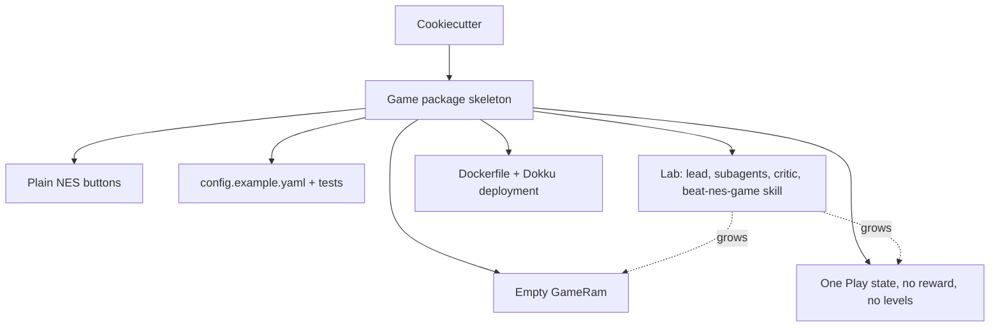

# Retro Speedlab Cookiecutter

[](https://github.com/datenwissenschaften/retro-speedlab/actions/workflows/ci.yml)  [](LICENSE)

A Cookiecutter template that scaffolds a game package for [Retro Speedlab](https://www.retrospeedlab.com), the lab
that searches the fastest run of a retro game frame by frame from power-on. The
[Retro Speedlab Core](https://github.com/datenwissenschaften/retro-speedlab-core) engine runs a Go-Explore TAS search
on savestates: it beats each level on its own from a savestate at its start (`levels.msgpack`), then builds the full
run from power-on. The game package tells it what the game is: the RAM map, the actions, and the states of one run,
grouped into levels. Scheduled Claude Code lab runs grow the package whenever the search is stuck or stalls.

## What it generates



The template ships no game knowledge, no notes, no lab reports and no lessons. Everything a game needs (RAM map,
`position()`, `remaining_lives()`, `dynamics()`, states, rewards, levels) is built by the lab runs, which follow the
bundled `.claude/skills/beat-nes-game/SKILL.md`.

## Quick start

```bash
pipx install cookiecutter
cookiecutter https://github.com/datenwissenschaften/retro-speedlab
git clone https://github.com/datenwissenschaften/retro-speedlab-core
cd retro-speedlab-game
cp config.example.yaml config.yaml
poetry install
poetry run python app.py
```

The engine is a sibling checkout (`../retro-speedlab-core`, a Poetry path dependency); `dokku/deploy.sh` builds the
image from it. Fill in the `speedrun` section of `config.yaml` and put the ROM you own as `roms/<game>.nes` first.

### Template variables

| Variable | Purpose |
| --- | --- |
| `project_name` | Human-readable project name |
| `project_slug` | Distribution, directory, Dokku app and `speedrun.id`, derived from `project_name` |
| `game` | Stable Retro game id, for example `SuperMarioBros-Nes-v0` |
| `game_title` | Title shown on the stream, derived from `game` |
| `author_name` | Package author |
| `author_email` | Package author email, also the lab run's git identity |

## Generated project structure

```text
retro-speedlab-game/
├── .claude/
│   ├── agents/              scout, researcher, engineer, verifier
│   ├── settings.json
│   └── skills/beat-nes-game/
├── agent/
│   ├── daily.sh             one lab run on its own git worktree
│   ├── PROMPT.md            the lead's prompt
│   ├── verify.sh            ruff, pytest and the level routes' replay
│   ├── work_in_progress.sh
│   ├── critic.sh            lessons from the last five reports
│   ├── CRITIC.md
│   ├── lessons.py
│   └── reports/
├── dokku/                   setup.sh, deploy.sh, settings.sh
├── app.py                   Flyte workflows: speedrun (default) and lab
├── config.example.yaml
├── Dockerfile
├── pyproject.toml
├── integrations/
├── roms/
├── src/
│   ├── game/actions.py, wrapper.py
│   ├── ram/game.py
│   └── states/play.py
└── tests/
```

## Lab runs

The search runs around the clock in a [Dokku](https://dokku.com) app. Every `agent.schedule` the Flyte task `lab`
starts a lab run when the search is stuck in a segment or the movie made no progress for `agent.stall_minutes`
minutes. The lead gets `agent.minutes` minutes on branch `lab/<start>/claude` and delegates to its subagents; the
branch is merged and deployed only when it has commits and `agent/verify.sh` passes, so every level route still
replays. Unverified work gets one extension of `agent.extension_minutes`. After five new reports the critic writes
at most five lessons to `agent/LESSONS.md`, which every lead reads first.

## Testing the template

```bash
poetry install
poetry run ruff check --config pyproject.toml .
poetry run ruff format --config pyproject.toml --check .
poetry run pytest tests/
```

The tests bake real projects and inspect them. CI (`.github/workflows/ci.yml`) additionally bakes a project next to a
checkout of the engine, installs it, and runs its ruff checks, its tests and an import of `app.py`. The
`--config pyproject.toml` flag keeps Ruff from reading the generated project's own `pyproject.toml`, which is not
valid TOML until it is rendered.

## ROM and licensing notes

This repository never bundles ROMs, copyrighted game assets or credentials. The generated `.gitignore` excludes ROMs,
`working/` output, `*.bk2` movies and `config.yaml`, which holds the keys; only `config.example.yaml` is committed.
You are responsible for only using ROMs you have the legal right to use.

## License

GPL-3.0-only
